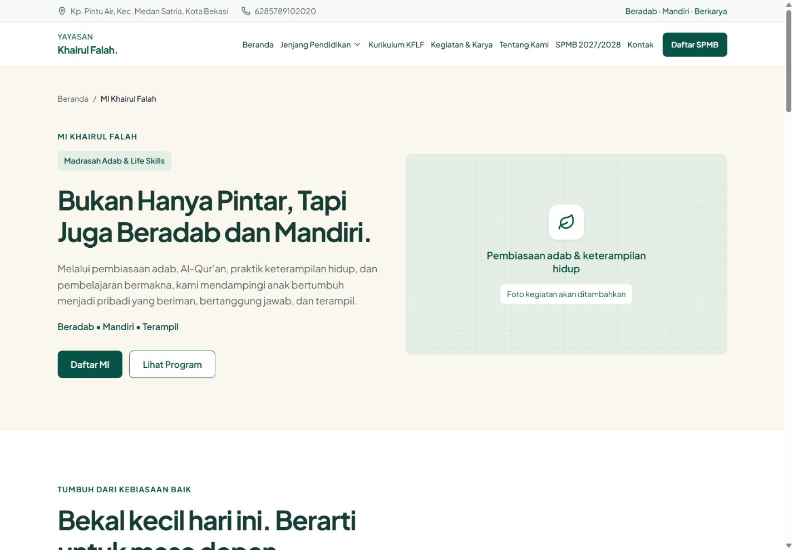
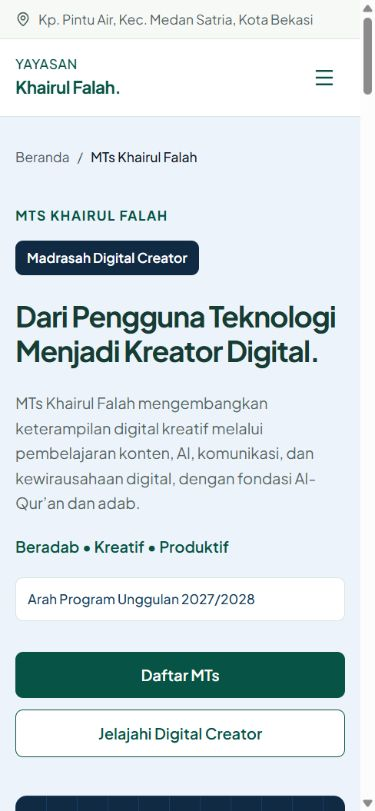
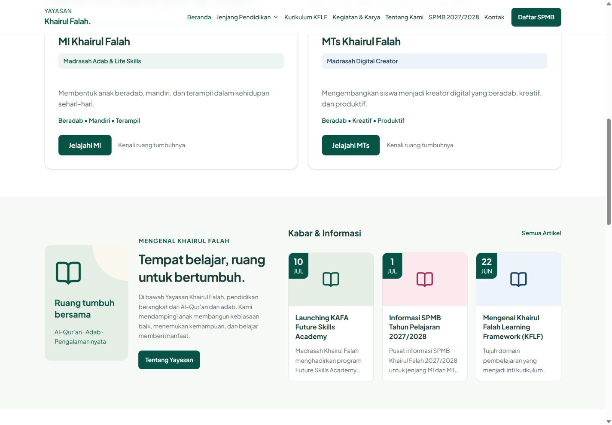

# Preview redesign Khairul Falah 2027/2028

Preview yang diuji: [https://khairulfalah-mo6l8tjcb-wahidhas-projects.vercel.app](https://khairulfalah-mo6l8tjcb-wahidhas-projects.vercel.app). Branch: `codex/brand-identity-2027-2028`. Production tidak diubah.

| Halaman | Desktop (1440 × 1000) | Mobile (390 × 844) |
| --- | --- | --- |
| [Homepage](https://khairulfalah-mo6l8tjcb-wahidhas-projects.vercel.app/) |  |  |
| [MI](https://khairulfalah-mo6l8tjcb-wahidhas-projects.vercel.app/mi) |  |  |
| [MTs](https://khairulfalah-mo6l8tjcb-wahidhas-projects.vercel.app/mts) |  |  |
| [SPMB](https://khairulfalah-mo6l8tjcb-wahidhas-projects.vercel.app/ppdb) |  |  |

## Detail pendukung

Ilustrasi portal, rancangan journey, dan status galeri kosong sesuai brief.

## Hasil pemeriksaan

- 42 pemeriksaan lebar viewport, enam halaman, tanpa overflow horizontal atau gambar rusak.
- Menu mobile/desktop dan Escape mengembalikan fokus dengan benar.
- FAQ membuka jawaban, CTA jenjang menuju halaman SPMB yang tepat.
- Canonical `.my.id`, noindex pada preview, dan tidak ada console error pada sesi uji.
- Capture di atas merupakan viewport; full-page capture browser gagal pada sesi ini. Tidak dilakukan manipulasi gambar.
- Detail ukuran disimpan di [responsive-results.json](screenshots/reference-responsive-results.json).
- Lighthouse dan audit WCAG menyeluruh belum diukur.

## Komposisi mengikuti referensi

Bar kontak, hero dua kolom, kartu SPMB mengambang, empat sorotan fondasi, dan ringkasan kabar. Warna tetap hijau–emas sesuai identitas Khairul Falah. Visual hero merupakan ilustrasi berlabel dari aset proyek, bukan dokumentasi siswa.

Pengujian ulang mencakup lebar 320, 390, 768, 1024, 1200, 1280, dan 1440 piksel, masing-masing pada enam halaman. CTA kartu SPMB, pilihan jenjang, pendaftaran MTs, dan Escape/fokus menu mobile berjalan; console error tidak ditemukan pada sesi uji. Screenshot detail portal/journey di atas berasal dari review awal, dengan konten program yang tetap sama.
