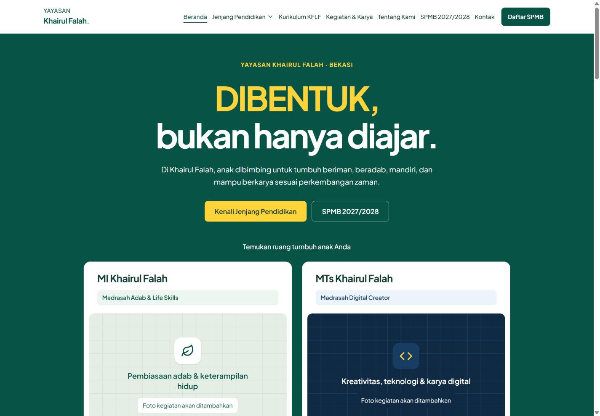
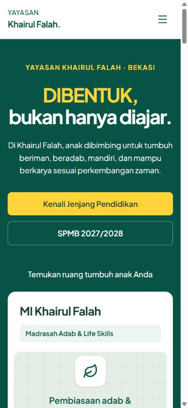
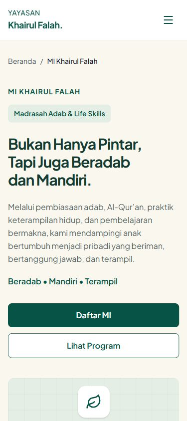
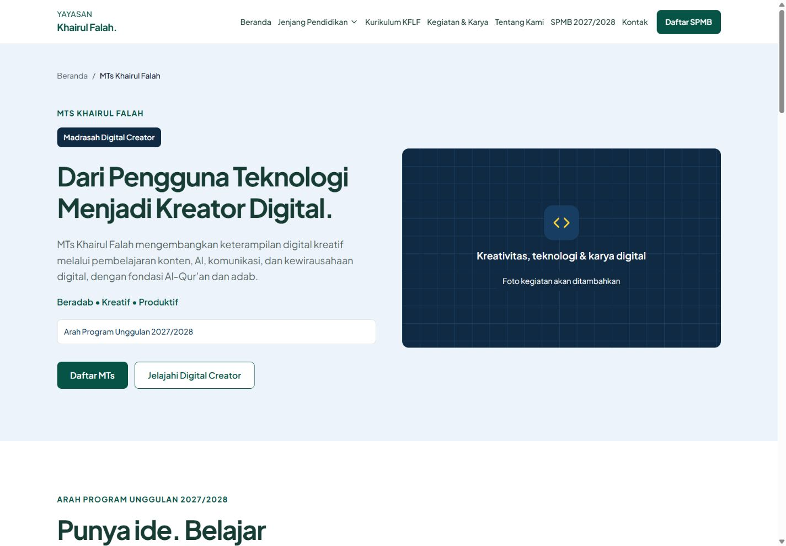
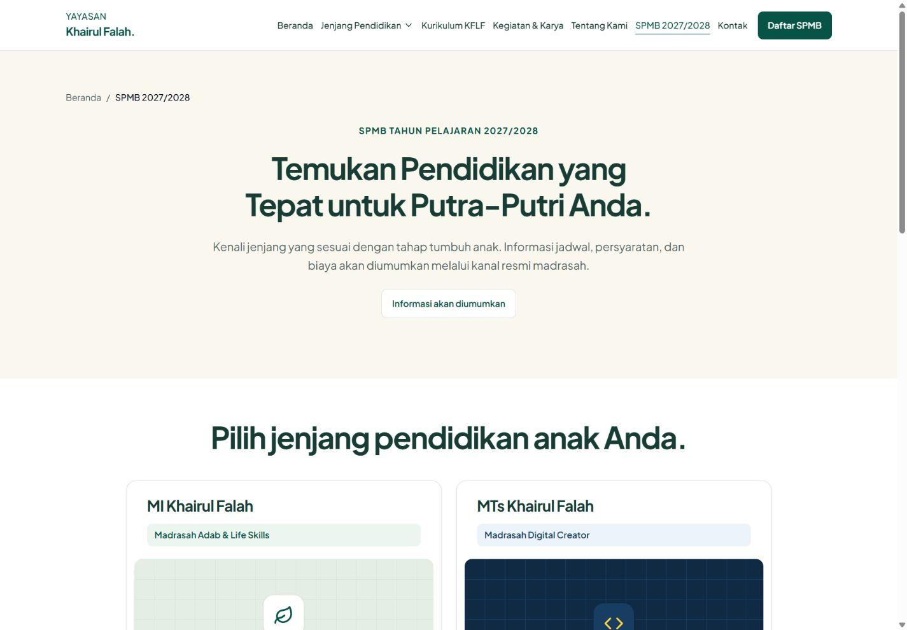
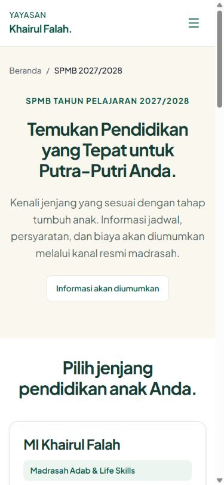
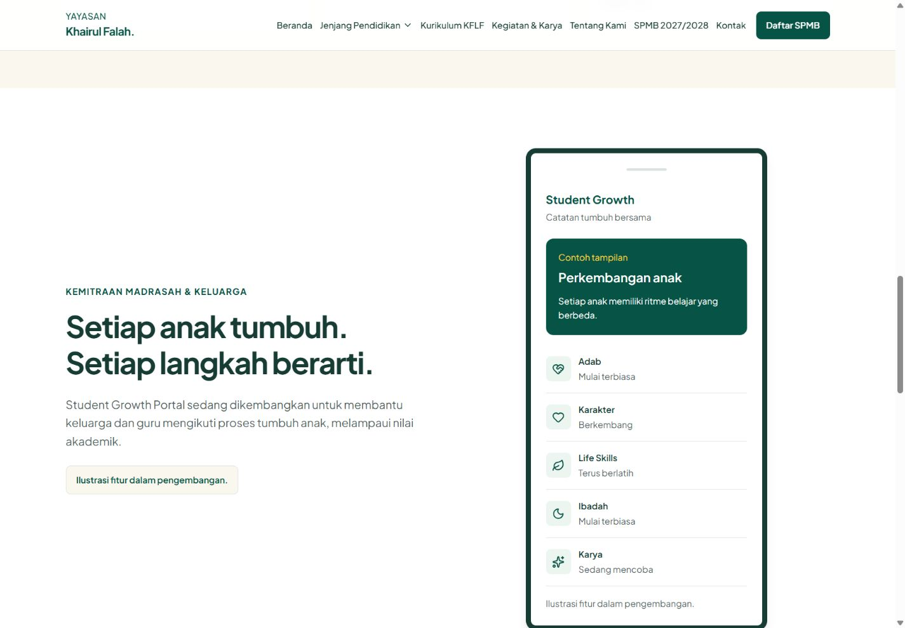
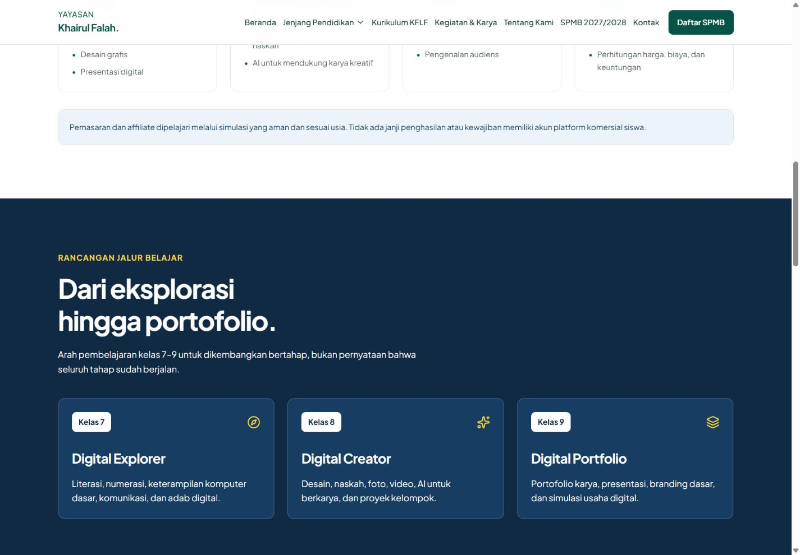
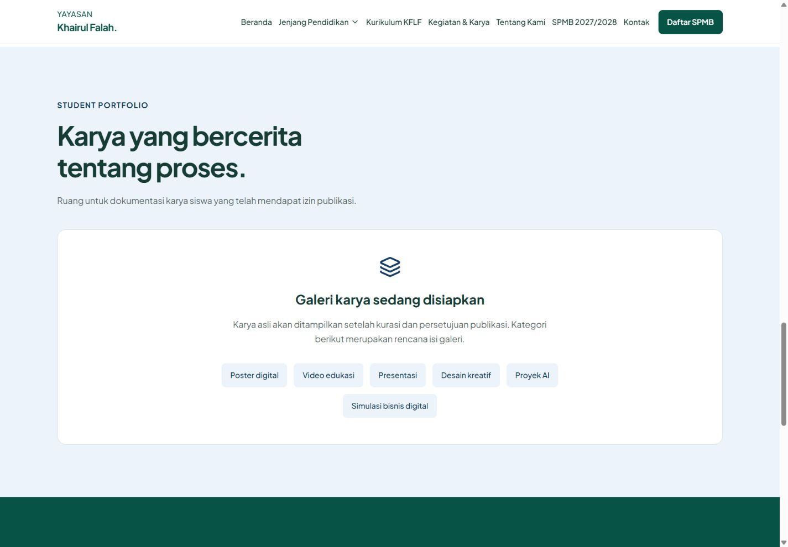

# Preview redesign Khairul Falah 2027/2028

Preview yang diuji: [https://khairulfalah-8v4e2kxp3-wahidhas-projects.vercel.app](https://khairulfalah-8v4e2kxp3-wahidhas-projects.vercel.app). Branch: `codex/brand-identity-2027-2028`. Production tidak diubah.

| Halaman | Desktop (1440 × 1000) | Mobile (390 × 844) |
| --- | --- | --- |
| [Homepage](https://khairulfalah-8v4e2kxp3-wahidhas-projects.vercel.app/) |  |  |
| [MI](https://khairulfalah-8v4e2kxp3-wahidhas-projects.vercel.app/mi) |  |  |
| [MTs](https://khairulfalah-8v4e2kxp3-wahidhas-projects.vercel.app/mts) |  |  |
| [SPMB](https://khairulfalah-8v4e2kxp3-wahidhas-projects.vercel.app/ppdb) |  |  |

## Detail pendukung

Ilustrasi portal, rancangan journey, dan status galeri kosong sesuai brief.

## Hasil pemeriksaan

- 36 pemeriksaan lebar viewport, enam halaman, tanpa overflow horizontal atau gambar rusak.
- Menu mobile/desktop dan Escape mengembalikan fokus dengan benar.
- FAQ membuka jawaban, CTA jenjang menuju halaman SPMB yang tepat.
- Canonical `.my.id`, noindex pada preview, dan tidak ada console error pada sesi uji.
- Capture di atas merupakan viewport; full-page capture browser gagal pada sesi ini. Tidak dilakukan manipulasi gambar.
- Detail ukuran disimpan di [responsive-results.json](screenshots/responsive-results.json).
- Lighthouse dan audit WCAG menyeluruh belum diukur.
